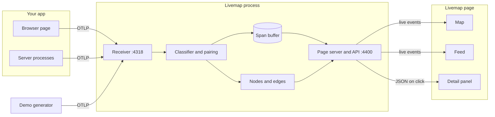

# Livemap PRD

Oct 9, 2026 · Donald Miller

## 1. Overview

Livemap is a local tool that shows any running app as a live animated map. Every HTTP call, database query, LLM call, agent step and queue message lights up as it happens, and a click shows what was sent and what came back. Livemap is a working name.

| Reference | What we recreate | What we skip |
| --- | --- | --- |
| [agenttrail](https://github.com/sodiumsun/agenttrail) | One small local daemon, one static page, live push to the browser, one command to start, no account | File watching, PLAN.md, coding-agent hooks |
| [Vizceral](https://github.com/Netflix/vizceral) | Traffic drawn as particles flowing between nodes | Multi-region views, WebGL, its data format |
| [Jaeger](https://github.com/jaegertracing/jaeger) | Following one request through every hop as a waterfall | Storage back ends, search, sampling |
| [otel-desktop-viewer](https://github.com/CtrlSpice/otel-desktop-viewer) | A local OpenTelemetry receiver with nothing to configure | Its static, after-the-fact trace list |
| [Langfuse](https://github.com/langfuse/langfuse) and [Phoenix](https://github.com/Arize-ai/phoenix) | The LLM call view: model, prompt, response, tokens, latency | Datasets, evals, prompt management, accounts |

### The problem

A running app is invisible. Logs arrive as text after the fact, and tracing tools show one finished request at a time in a table. Nothing shows the whole app moving, so a developer cannot see at a glance which parts are talking, which call is slow, or what an agent just asked a model.

## 2. Goals and non-goals

Version 1 succeeds when a developer can point any instrumented app at Livemap and watch it work in real time.

### Goals

1. Show every call an app makes as a moving mark on a map, within half a second of it finishing.
2. Cover five kinds of activity: HTTP and API calls, database queries, LLM calls, agent and tool steps, and queue messages.
3. Let one click reveal what was sent, what came back, how long it took and whether it failed.
4. Work with any language or framework that can emit OpenTelemetry, with no change to the app's own code paths.
5. Start with one command, with no account, no configuration file and no data leaving the machine.
6. Be useful in the first ten seconds through a built-in demo that needs no app at all.

### Non-goals

- Running against staging or production, remote access, or any login.
- Saving history to disk, replaying past sessions, or searching old traces.
- Team features: sharing, comments, multiple users.
- Metrics dashboards, alerting, or log search.
- LLM evaluation, prompt management, datasets, or cost budgeting.
- Watching coding agents edit files. That is agenttrail's job.
- Capturing traffic without a hookup, such as a network proxy or packet sniffing.
- A declared architecture file that flags unexpected traffic. This is a candidate for version 2.
- Mobile layout, plugins, or theming.

## 3. Users and user stories

The user is a solo developer building an app on their own machine, often one that calls LLMs or runs agents. They want to see what the app is doing without reading logs.

| # | As a user, I want to… | So that… |
| --- | --- | --- |
| U1 | see every call animate between the parts of my app as it happens | I know the app is alive and where traffic is going |
| U2 | click any call and read what was sent and what came back | I can debug without adding print statements |
| U3 | see each LLM call with its model, prompt, response and token counts | I know what the model was asked and what it cost |
| U4 | follow one request through every hop it made | I can find the slow or failing step |
| U5 | see an agent's steps and tool calls in order | I understand what the agent actually did |
| U6 | have failures stand out in red | I notice errors the moment they happen |
| U7 | hook up any app with a few lines and no code changes | the tool works on every project I have |
| U8 | try it with a built-in demo before hooking anything up | I see the value in seconds |
| U9 | hide prompt and response text with one switch | I can share my screen safely |
| U10 | filter the view by kind of call | I can focus on only LLM calls or only errors |

## 4. Functional requirements

Requirements are grouped by area. P0 means version 1 must have it, P1 means version 1 should have it, and P2 means later. A span is one recorded call, in OpenTelemetry's terms.

### Ingest (I)

| ID | Requirement | Priority |
| --- | --- | --- |
| I1 | Accept OpenTelemetry traces at `POST /v1/traces` on `127.0.0.1:4318`, as `application/json` and as `application/x-protobuf` | P0 |
| I2 | Accept gzip-compressed request bodies | P0 |
| I3 | Reply 200 with an empty export response in the same content type as the request | P0 |
| I4 | Reject a malformed or over-10 MB body with 400 and keep running | P0 |
| I5 | Hold the newest 5,000 spans in memory, drop the oldest first, and never write to disk | P0 |
| I6 | Bind every listener to `127.0.0.1` only | P0 |
| I7 | Accept `POST /v1/logs`: attach log records whose event name starts with `gen_ai.` to the span with the same span id, as message content, and discard all other logs. Accept `POST /v1/metrics` and discard the body. Both reply 200. | P0 |
| I8 | Allow cross-origin posts to `/v1/traces` from `localhost` and `127.0.0.1` origins, for the browser hookup | P1 |
| I9 | Accept OpenTelemetry over gRPC on port 4317 | P2 |

### Classify (K)

| ID | Requirement | Priority |
| --- | --- | --- |
| K1 | Create one node per `service.name`, of kind service | P0 |
| K2 | Give every span one kind: llm, agent, tool, db, queue, http or internal, using the rules in section 6 | P0 |
| K3 | For a client span with no matching server span, create an external node named from the database system, LLM provider, queue system or host, in that order | P0 |
| K4 | Derive one edge per pair of nodes that exchange a call, directed from caller to callee | P0 |
| K5 | Recognise LLM, agent and tool spans from the OpenTelemetry GenAI attributes (`gen_ai.*`), current and legacy names | P0 |
| K6 | Show agent and tool spans as a ring pulse on their own service node, since they have no second node to travel to | P0 |
| K7 | Keep internal spans off the map and the feed; show them only in the trace waterfall | P0 |
| K8 | Also recognise LLM spans written in the OpenInference and OpenLLMetry conventions | P1 |
| K9 | Mark a node as kind browser when its SDK language is `webjs` | P0 |

### Map (M)

| ID | Requirement | Priority |
| --- | --- | --- |
| M1 | Add a node or edge the first time it is seen, with no page reload | P0 |
| M2 | Lay nodes out in three columns, left to right: browsers and Outside; services; then databases, queues, LLM providers and external APIs. Within a column, nodes stack in order of first appearance. | P0 |
| M3 | Never move an existing node when a new one appears | P0 |
| M4 | Draw one particle per span, travelling its edge from caller to callee, with travel time equal to the span's duration clamped to 300–2,000 ms | P0 |
| M5 | Colour particles by kind, with a legend; draw failed spans red and flash their edge and callee node red for 2 seconds | P0 |
| M6 | Show at most 150 particles at once; beyond that, merge spans on the same edge within 100 ms into one larger particle carrying a count | P0 |
| M7 | Show a "Waiting for traffic" state with the hookup lines to copy when no span has arrived | P0 |
| M8 | Show calls in the last 60 seconds on each node, and count plus median duration on each edge | P1 |
| M9 | Dim a node to 40% opacity after 60 seconds without traffic | P1 |
| M10 | Clicking a node or an edge filters the feed to it | P1 |
| M11 | Under `prefers-reduced-motion`, replace particles with a 300 ms edge highlight | P1 |
| M12 | Let the user drag nodes, and remember positions in the browser | P2 |

### Feed (F)

| ID | Requirement | Priority |
| --- | --- | --- |
| F1 | List one row per drawn call or pulse, newest first: kind icon, name, caller → callee, duration, status and clock time | P0 |
| F2 | Show a new row within 500 ms of the span arriving, and keep at most 500 rows on the page | P0 |
| F3 | Clicking a row opens the detail panel and highlights that span's edge on the map | P0 |
| F4 | Filter by kind, by "errors only" and by text in the name | P1 |
| F5 | Stop inserting rows at the top while the user has scrolled down, and show an "N new" pill that jumps back up | P1 |
| F6 | A Pause button freezes the map and feed while spans keep buffering; Resume catches up | P1 |
| F7 | A Clear button empties the buffer, the feed and the map counts | P1 |

### Detail (D)

| ID | Requirement | Priority |
| --- | --- | --- |
| D1 | Show the span's name, kind, service, start time, duration, status and every attribute as a key and value | P0 |
| D2 | Show a waterfall of every span in the same trace, indented by parent and scaled to time, with the selected span highlighted; clicking another span selects it | P0 |
| D3 | For an LLM span, show provider, model, input tokens, output tokens, finish reason, the messages by role, the response and any tool calls. Content is read from span attributes, span events or attached log events; when none is present, show `Content not captured`. | P0 |
| D4 | For an HTTP span, show method, route or URL and status code; for a database span, show the system and the statement | P0 |
| D5 | For a failed span, show the exception type, message and stack trace | P1 |
| D6 | A "Hide content" switch replaces prompts, responses, database statements and URL query strings on screen with `[hidden]`, and stays set across reloads | P1 |
| D7 | Add late-arriving spans to an open waterfall without closing it | P1 |
| D8 | Copy the selected span as JSON | P2 |

### Command line and demo (X)

| ID | Requirement | Priority |
| --- | --- | --- |
| X1 | `npx livemap` starts the receiver and the page, then prints the page address and the hookup lines | P0 |
| X2 | Flags: `--port` (default 4400), `--otlp-port` (default 4318), `--max-spans` (default 5000) | P0 |
| X3 | If a port is taken, exit with code 1 and a message naming the port and the flag that changes it | P0 |
| X4 | `livemap demo` starts Livemap and plays a scripted app through the real receiver: browser, web, API, Postgres, Redis, an LLM provider, an agent with two tool calls, a queue and a worker, with about one call in ten failing | P0 |
| X5 | Demo flags `--seed`, `--rate`, `--once` and `--target <receiver address>`; `--once` plays one fixed scenario and stops, so tests get identical data every run; `--target` sends to an already-running Livemap instead of starting one | P0 |
| X6 | `GET /healthz` returns `{"status":"ok","spans":<count>}` | P0 |
| X7 | Ctrl-C stops the process within 1 second | P0 |
| X8 | `--open` opens the page in the default browser | P1 |
| X9 | `livemap init` detects Node or Python in the current folder and prints the matching hookup lines; it changes no files | P1 |

### Hookups (H)

| ID | Requirement | Priority |
| --- | --- | --- |
| H1 | Any OpenTelemetry SDK reports to Livemap through environment variables alone: endpoint, protocol, exporter and a 200 ms batch delay | P0 |
| H2 | A tested Node recipe and example app: add the auto-instrumentation package and one start flag, with no source change | P0 |
| H3 | A tested Python recipe and FastAPI example app: add the OpenTelemetry distro and start through its launcher, with no source change | P0 |
| H4 | LLM recipes for Node and Python: the instrumentation package to add and the setting that turns on prompt and response capture | P0 |
| H5 | Example apps call a local mock LLM server that speaks the OpenAI-compatible chat API and gives scripted answers, so they run with no API key. An optional smoke suite points the same examples at a real model when a key is supplied. | P0 |
| H6 | A browser recipe and example page whose fetch calls join the same trace as the server spans they cause | P1 |
| H7 | Written, untested recipes for Go, Java, .NET and Ruby | P2 |

## 5. Non-functional requirements

Livemap must feel instant, stay small and never send data anywhere.

| Area | Requirement |
| --- | --- |
| Latency | A span is on the map and in the feed within 500 ms of reaching the receiver (95th percentile) |
| Start-up | The page is reachable within 1 second of running the command |
| Throughput | 200 spans per second sustained, with the map at 30 frames per second or better on a 2020-or-newer laptop |
| Memory | Under 200 MB for the process with a full 5,000-span buffer |
| Reliability | A bad payload, a dropped browser connection or a full buffer never stops the process; the page reconnects on its own within 3 seconds |
| Security | Listens on `127.0.0.1` only; makes no outbound network connection; writes no file; collects no telemetry |
| Deployment | One npm package run with `npx`; Node 20 or newer; macOS, Linux and Windows |
| Configuration | Command-line flags only; no configuration file and no environment file required |
| Dependencies | At most one runtime dependency, for decoding protobuf; the page uses no framework and has no build step |
| Testability | The demo's `--once` mode gives identical spans every run; LLM calls in tests go to the scripted mock server, and only the optional smoke suite calls a real model; `POST /api/clear` resets state between tests; every interactive element has a `data-testid`; the page exposes its node, edge and particle counts through `window.__livemap.stats()`, so no test reads pixels |
| Accessibility | Feed and detail panel work by keyboard; kind is shown by icon and label as well as colour; reduced-motion is respected |
| Cost | Free to run; no paid service or API key is needed, including for the examples |

### Licensing

| Project | Licence | Implication |
| --- | --- | --- |
| [agenttrail](https://github.com/sodiumsun/agenttrail) | MIT | Code may be copied if its licence notice is kept. The plan copies ideas only. |
| [Vizceral](https://github.com/Netflix/vizceral) | Apache-2.0 | Visual idea only; no code. Netflix no longer maintains it. |
| [Jaeger](https://github.com/jaegertracing/jaeger) | Apache-2.0 | Waterfall idea only; no code. |
| [otel-desktop-viewer](https://github.com/CtrlSpice/otel-desktop-viewer) | Apache-2.0 | Receiver idea only; no code. |
| [Langfuse](https://github.com/langfuse/langfuse) | MIT, except its `ee` folders | Functionality only; no code. |
| [Phoenix](https://github.com/Arize-ai/phoenix) | Custom, not a standard open-source licence | Functionality only; no code. |
| OpenTelemetry protocol definitions | Apache-2.0 | Bundled to decode protobuf; keep the notice. |
| Livemap | MIT | Assumed; see open questions. |

## 6. Technical architecture

Livemap is one Node process that receives OpenTelemetry spans, sorts them into nodes and edges in memory, and pushes them to a static page over server-sent events.

### Stack

| Layer | Choice | Why |
| --- | --- | --- |
| Runtime | Node 20 or newer, ES modules, plain JavaScript with JSDoc types | Runs through `npx` with no build step, as agenttrail does |
| HTTP | `node:http` | Two small listeners need no framework |
| Protobuf | `protobufjs` with the OpenTelemetry trace definitions bundled as JSON | Most SDKs send protobuf by default; this is the one runtime dependency |
| Live push | Server-sent events | One-way, reconnects by itself, no dependency |
| Page | One `index.html` plus ES modules, no framework | No build step; small enough to read in one sitting |
| Map drawing | SVG for nodes and edges, one canvas layer for particles | SVG is testable and accessible; canvas keeps 150 particles smooth |
| State | In-memory arrays and maps | Live only; nothing to migrate or clean up |
| Unit tests | `node:test` | Built in |
| End-to-end tests | `@playwright/test` specs, plus a walkthrough with the `playwright-headless` MCP server | Proves the page, not just the API |
| Examples | Express app, FastAPI app, OpenAI-compatible mock LLM server, browser page bundled with esbuild | Each proves one hookup recipe |

### Data model

All of it lives in memory and is rebuilt from nothing on restart.

| Structure | Key fields | Notes |
| --- | --- | --- |
| Span | `traceId`, `spanId`, `parentSpanId`, `service`, `name`, `kind`, `otelKind`, `startMs`, `durationMs`, `status`, `attributes`, `events`, `source`, `target` | Ring buffer of 5,000; `source` and `target` are node ids, empty for internal spans |
| Node | `id`, `name`, `kind`, `column`, `row`, `firstSeen`, `lastSeen` | `column` and `row` are fixed when the node is created |
| Edge | `id`, `source`, `target`, `lastSeen`, rolling 60-second count and durations | `id` is `source>target` |
| Trace index | `traceId` → list of `spanId` | Entries leave when their spans leave the buffer |
| Address table | `host:port` → node id | Learned by pairing; lets later calls resolve at once |

### Key interfaces

| Name | Input | Effect |
| --- | --- | --- |
| `POST /v1/traces` (port 4318) | OpenTelemetry export request, JSON or protobuf, optionally gzip | Decode, classify, buffer and broadcast each span |
| `GET /events` | None | Event stream: `snapshot` on connect (nodes, edges, newest 500 feed rows), then `span`, `node`, `edge`, `node-removed` and `clear` |
| `GET /api/span/:spanId` | Span id | The full span with attributes and events |
| `GET /api/trace/:traceId` | Trace id | Every buffered span in the trace, for the waterfall |
| `POST /api/clear` | None | Empty the buffer, nodes, edges, address table and pending pairings; broadcast `clear`. Tests call it before each scenario. |
| `GET /healthz` | None | `{"status":"ok","spans":<count>}` |
| `GET /` (port 4400) | None | The page |

### Rules that are easy to get wrong

**Kind is decided by the first rule that matches.**

| Order | If the span has… | Kind |
| --- | --- | --- |
| 1 | `gen_ai.operation.name` of `invoke_agent` or `create_agent` | agent |
| 2 | `gen_ai.operation.name` of `execute_tool` | tool |
| 3 | any other `gen_ai.operation.name`, or a `gen_ai` provider attribute | llm |
| 4 | `db.system.name` or `db.system` | db |
| 5 | `messaging.system` | queue |
| 6 | `http.request.method`, `http.method` or `rpc.system` | http |
| 7 | none of the above | internal |

**One call, one particle.** A call between two instrumented services arrives twice: a client span from the caller and a server span from the callee. Livemap pairs them when the server span's parent is the client span, then draws one particle and one feed row, taken from the client span.

- The first client span to an unknown `host:port` waits up to 300 ms for its server span. If one arrives, the address is recorded as that service. If none arrives, the address becomes an external node.
- Later client spans to a known address are drawn at once.
- If a pairing is learned after an external node was drawn, that node is removed and its counts move to the service node.
- A server span with no parent is an entry request. It is drawn from a node named Outside.
- An HTTP client span whose parent is an LLM span in the same service is the same call seen twice. It is not drawn; it appears only in the waterfall.

**Arrival order does not matter.** A server span can arrive before its client span. It waits up to 300 ms for the client. If the client arrives, only the client is drawn. If it does not, the server span is drawn from Outside.

**Queues are nodes.** A producer span is drawn from its service to a queue node named from `messaging.system`. A consumer span is drawn from that queue node to its service. Neither waits for pairing.

**Spans arrive when calls finish.** OpenTelemetry reports a span after the call ends, and SDKs batch for 5 seconds by default. Every hookup recipe sets the batch delay to 200 ms. A 20-second LLM call still appears only when it completes.

**The page is a view, not a store.** It keeps only what it draws. Detail and waterfall data are fetched on click, so a reload loses nothing the process still holds.

## 7. Milestones

Six stages, each ending in something that can be seen working. Stages 0 to 4 are version 1's core; stage 5 adds the browser and the P1 polish.

| Stage | Scope | Done when |
| --- | --- | --- |
| 0. Skeleton | X1, X2, X3, X6, X7, I6, M7. Repository, package, command, both listeners, the empty page, `POST /api/clear`, the `window.__livemap.stats()` test hook, unit and end-to-end test harness, and every end-to-end spec written ahead of the features. | `npx livemap` prints the page address and hookup lines. `/healthz` returns `{"status":"ok","spans":0}`. The page shows "Waiting for traffic". A second copy exits with code 1 and names the port. |
| 1. Ingest and feed | I1–I5, K1, K2, K5, K7, F1, F2, X4, X5 | Posting the sample trace as JSON, and again as protobuf, adds the same rows to the feed within 500 ms. A malformed body gets 400 and the process stays up. `livemap demo --once` produces identical feed rows on two runs. The 5,001st span evicts the first. |
| 2. Map | K3, K4, K6, K9, M1–M6, and the pairing rules in section 6 | `livemap demo --once` shows the eight demo nodes in their columns with particles travelling the edges. A web-to-API call draws one particle, not two. A failing call turns its edge red for 2 seconds. An agent step pulses its service node. |
| 3. Detail | D1–D4, F3 | Clicking the demo's LLM row shows its model, both token counts, the user message and the response. The waterfall shows that request from browser to database with the clicked span highlighted. Clicking a database row shows its SQL statement. |
| 4. Hookups | H1–H5, I7 | With only the documented lines, the Node example shows an inbound request, an outbound call to the Python example as one edge, and an LLM call with its prompt. The Python example shows a SQLite query and an LLM call. No application source file imports OpenTelemetry; a separate setup file is allowed. |
| 5. Browser and polish | H6, I8, K8, M8–M11, F4–F7, D5–D7, X8, X9 | The example page appears as a browser node, and its fetch shares one waterfall with the server spans it caused. Hide content masks the demo prompt and stays on after a reload. `livemap demo --rate 200` holds 30 frames per second for 60 seconds with never more than 150 particles. Filtering to LLM leaves only LLM rows. |

## 8. Success metrics, risks and open questions

Version 1 is judged on speed to first value, hookup effort and staying out of the way.

### Metrics

| Metric | Target |
| --- | --- |
| Time from `npx livemap demo --open` to the first moving particle | Under 10 seconds |
| Lines added to hook up an existing Node or Python app | 5 or fewer, none in application source |
| Span received to span on screen, 95th percentile | Under 500 ms |
| Sustained load at 30 frames per second | 200 spans per second |
| Outbound network connections made by Livemap | 0 |
| End-to-end specs passing at final acceptance | 100% |

### Risks

| Risk | Likelihood | Mitigation |
| --- | --- | --- |
| An app with no OpenTelemetry hookup shows nothing | High | Demo mode for first run; `livemap init` prints the lines; the empty state shows them too |
| LLM attribute names differ between instrumentation libraries and versions | High | Accept current and legacy `gen_ai` names in stage 1; add OpenInference and OpenLLMetry in stage 5; unknown spans still appear as http |
| LLM instrumentations leave out prompt text unless a setting is on | High | Each LLM recipe names the setting; the detail panel says "content not captured" instead of showing blanks |
| SDK defaults to gRPC or a 5-second batch, so nothing appears or it lags | Medium | Recipes set protocol and batch delay explicitly; the empty state repeats both lines |
| Pairing guesses wrong and draws a call twice or to the wrong node | Medium | Pairing rules have their own unit tests and one end-to-end spec; a late pairing corrects the map |
| A busy app floods the map into noise | Medium | 150-particle cap with merging, kind filters and Pause |
| Port 4318 or 4317 is already held by another local tool | Medium | Clear exit message and `--otlp-port`; gRPC on 4317 is left for later |
| Prompts on screen during a screen share | Low | Hide content switch; nothing is written to disk |

### Open questions

- [x] Starting point: a fresh build that borrows agenttrail's architecture.
- [x] Main screen: map plus feed.
- [x] History: live only, held in memory.
- [x] Where it runs: the developer's own machine only.
- [x] LLM calls in tests: scripted mock server, plus an optional smoke suite against a real model.
- [x] Verification: committed Playwright specs plus a walkthrough with the `playwright-headless` MCP server.
- [ ] How apps report in: OpenTelemetry hookups only, with no zero-code proxy. Assumed.
- [ ] Name: Livemap is a placeholder. Check the npm name is free before publishing.
- [ ] First tested hookups: Node and Python. Assumed.
- [ ] Browser hookup ships in version 1 as stage 5. Assumed.
- [ ] Livemap's own licence: MIT. Assumed.
- [ ] Default ports: 4400 for the page and 4318 for the receiver. Assumed.

### References

- [agenttrail](https://github.com/sodiumsun/agenttrail)
- [Vizceral](https://github.com/Netflix/vizceral)
- [Jaeger](https://github.com/jaegertracing/jaeger)
- [otel-desktop-viewer](https://github.com/CtrlSpice/otel-desktop-viewer)
- [Langfuse](https://github.com/langfuse/langfuse)
- [Phoenix](https://github.com/Arize-ai/phoenix)
